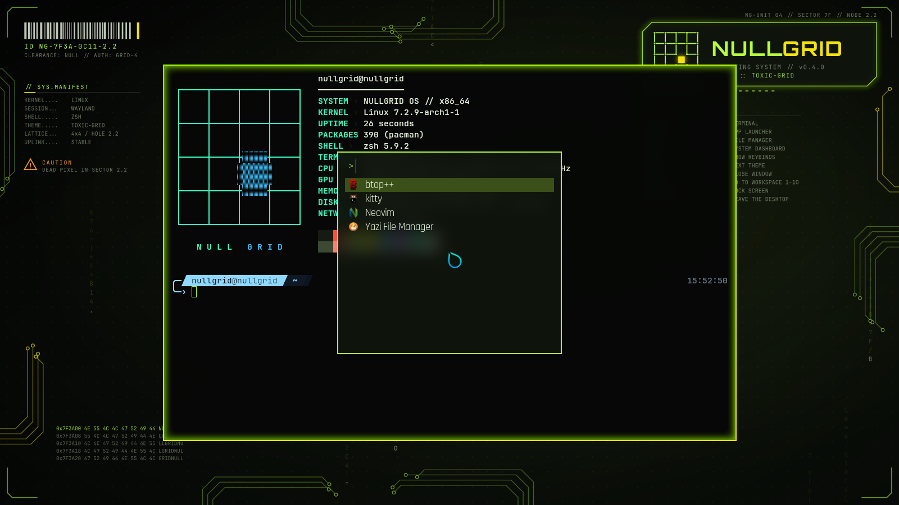
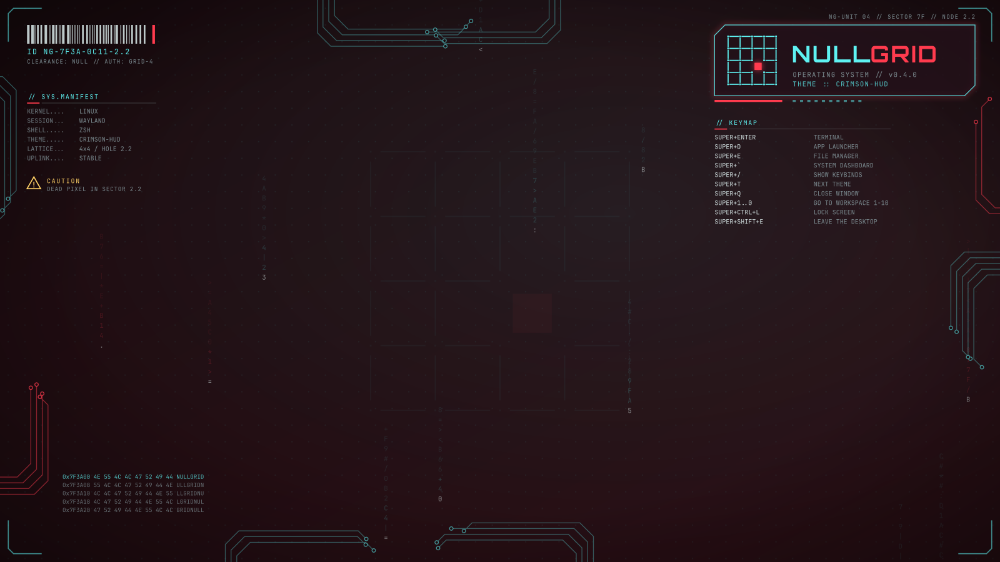

# NULLGRID OS

A lightweight, terminal-first Arch Linux distro with a cyberpunk HUD look:
dark crimson, neon cyan, chamfered frames, live system widgets and subtle UI sounds.
It's meant to run on old ThinkPads, Raspberry Pis (planned) and DIY cyberdecks.

> Status: **phase 4 (compositor + window styling)**. The ISO boots into a Hyprland desktop with
> neon window borders and a generated HUD wallpaper (Sway as fallback and lite session), or into
> a themed TTY dashboard in TTY mode. zsh + starship, kitty, neovim, yazi, btop, lazygit, tmux
> and fastfetch are all styled from one TOML file by the `nullgrid` tool. The dock, bar, widgets
> and sounds come in later phases (see `CLAUDE.md` section 9).

## Screenshots

Taken by `make test-boot` on the live ISO in QEMU (1600x900, software rendering).

| | |
|---|---|
|  |  |
| **Desktop** (crimson-hud): Hyprland, kitty with fastfetch, the HUD wallpaper | **Live theme switch**: `nullgrid theme set toxic-grid` restyles borders, terminal and wallpaper without logging out |
|  |  |
| **`SUPER+/`**: the keybinds, from the same file Hyprland and Sway use | **`SUPER+D`**: the app launcher (fuzzel) |
|  |  |
| **Sway**: the fallback and `lite` session | **TTY mode**: the dashboard on the Linux console |
|  |  |
| **The wallpaper** alone: circuit traces, logo plate, keymap, data blocks, all generated | ...and in ice-protocol |

## Quick start

```sh
make iso         # build out/nullgrid-*.iso inside Docker (any Linux host)
make run         # boot it in QEMU (UEFI); needs qemu + OVMF on the host
make test        # unit + snapshot tests of the nullgrid tool (Docker)
make test-boot   # headless boot test; needs only Docker
```

```sh
nullgrid theme list               # crimson-hud, ice-protocol, toxic-grid
nullgrid theme set ice-protocol   # restyle everything live
nullgrid keys                     # the desktop keybinds (SUPER+/ shows them too)
nullgrid mode tty                 # log in to the TTY dashboard instead of the desktop
nullgrid doctor                   # check config and generated files
```

See [docs/BUILDING.md](docs/BUILDING.md) for requirements and details.

## Docs

- [BUILDING.md](docs/BUILDING.md): build and run
- [CUSTOMIZING.md](docs/CUSTOMIZING.md): `nullgrid.toml`, themes, templates
- [DESKTOP.md](docs/DESKTOP.md): the desktop session, keybinds, wallpaper
- [TERMINAL.md](docs/TERMINAL.md): shell, apps, TTY mode and the dashboard
- [DECISIONS.md](docs/DECISIONS.md): design choices and why
- [STYLE.md](docs/STYLE.md): visual style guide
- [LOGO.md](docs/LOGO.md): the logo
- [assets/LICENSES.md](assets/LICENSES.md): licenses of all bundled assets

## License

MIT (see `LICENSE`). Bundled third-party assets keep their own licenses (see `assets/LICENSES.md`).
