# NULLGRID OS

A lightweight, terminal-first Arch Linux distro with a cyberpunk HUD look:
dark crimson, neon cyan, chamfered frames, live system widgets and subtle UI sounds.
It's meant to run on old ThinkPads, Raspberry Pis (planned) and DIY cyberdecks.

> Status: **phase 8 (installer)**. The ISO boots through an animated Plymouth splash
> into a Hyprland desktop (Sway as fallback and lite session) with the NULLGRID shell: status bar,
> dock, HUD widgets, start menu, notifications and a HUD lock screen, over a generated wallpaper,
> with synthesized UI sounds on PipeWire. GTK and Qt apps (Firefox, Thunar, zathura...), the icon
> theme and the mouse pointer follow the theme too, live. TTY mode gives a themed dashboard
> instead. `nullgrid-install` puts the system on a disk (offline, optional encryption, UEFI and
> BIOS) with a text greeter and a first-run wizard. Everything is styled from one TOML file by the
> `nullgrid` tool. Polish and performance come next (see `CLAUDE.md` section 9).

## Screenshots

Taken by `make test-boot` on the live ISO in QEMU (1600x900, no 3D: software rendering).

| | |
|---|---|
| 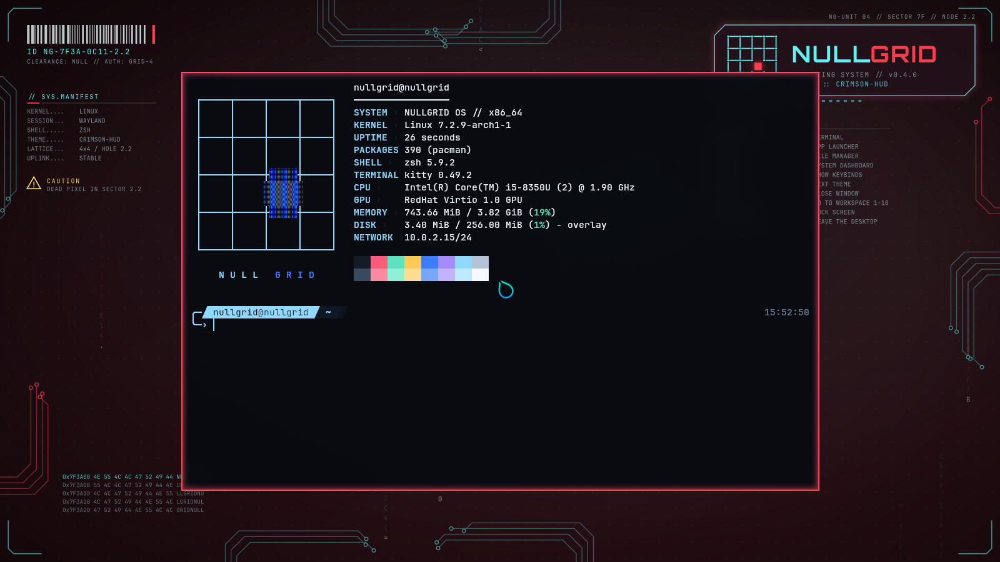 | 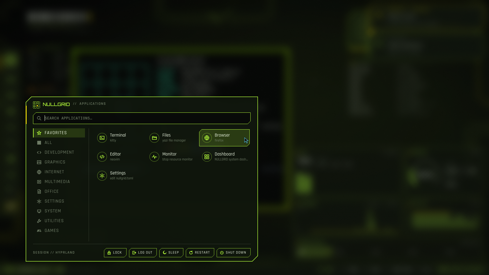 |
| **Desktop** (crimson-hud): status bar, dock, HUD widgets, the login terminal, the generated wallpaper | **Start menu** (`SUPER+SPACE`): search, categories, favorites, power |
| 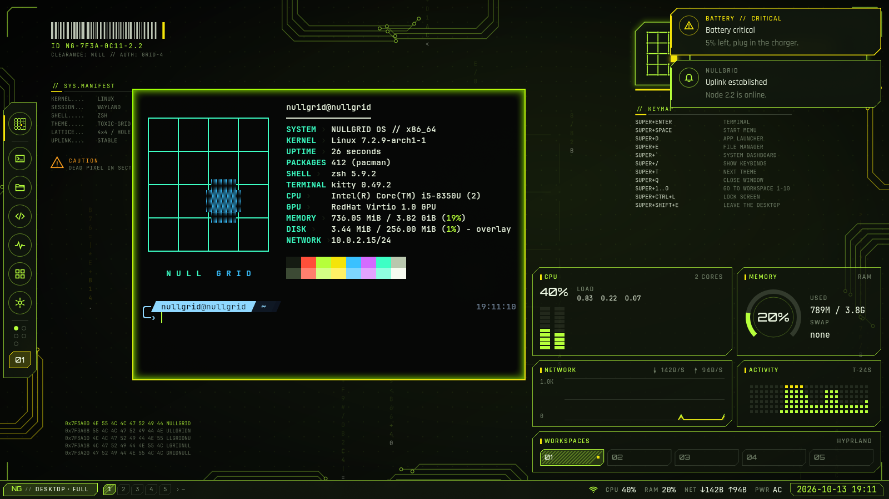 | 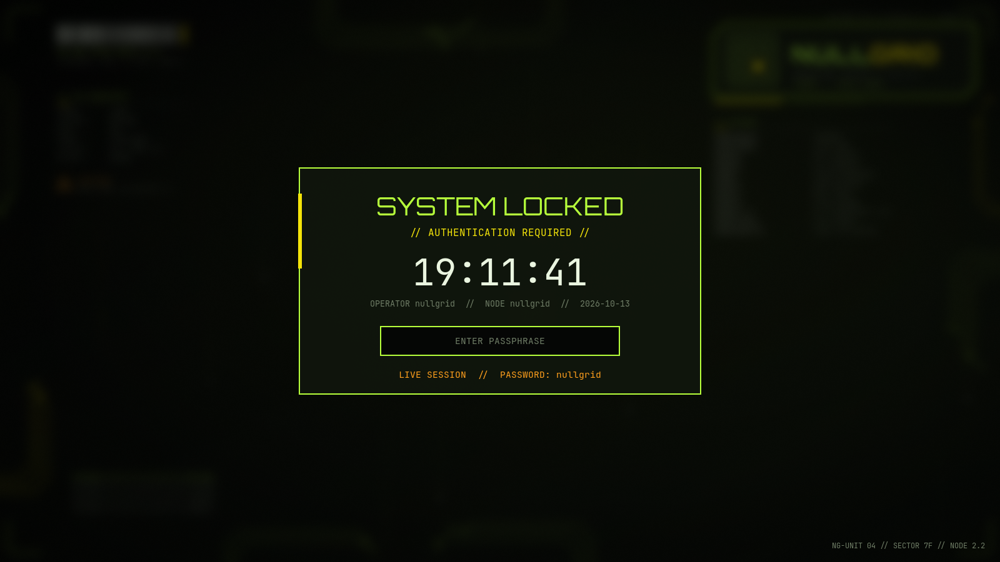 |
| **`nullgrid theme set toxic-grid`** restyles everything live; notifications (critical in red) | **Lock screen** (`SUPER+CTRL+L`) |
| 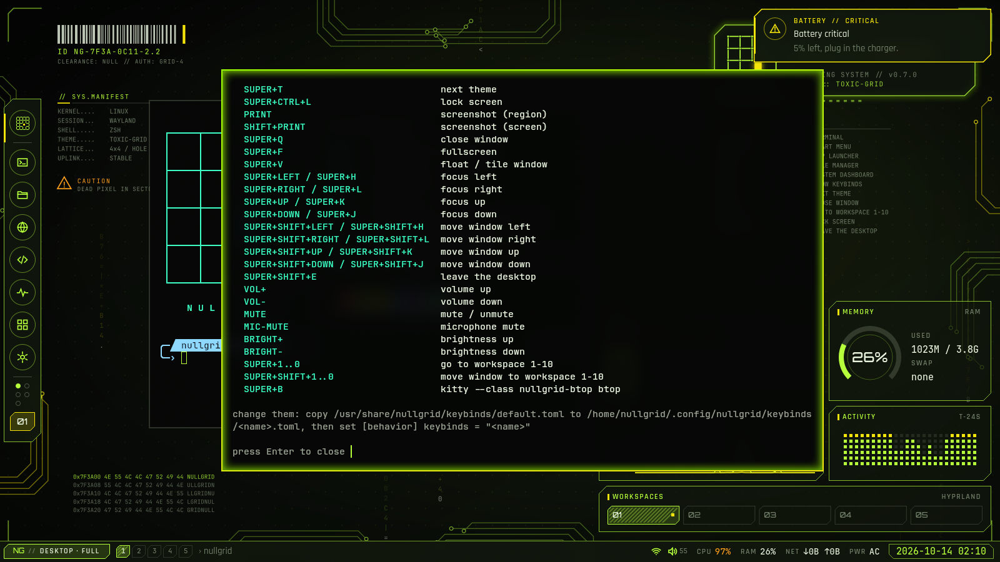 | 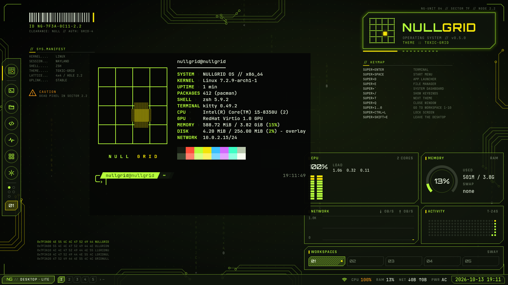 |
| **`SUPER+/`**: the keybinds, from the same file Hyprland and Sway use | **Sway**: the fallback and `lite` session, same shell |
| 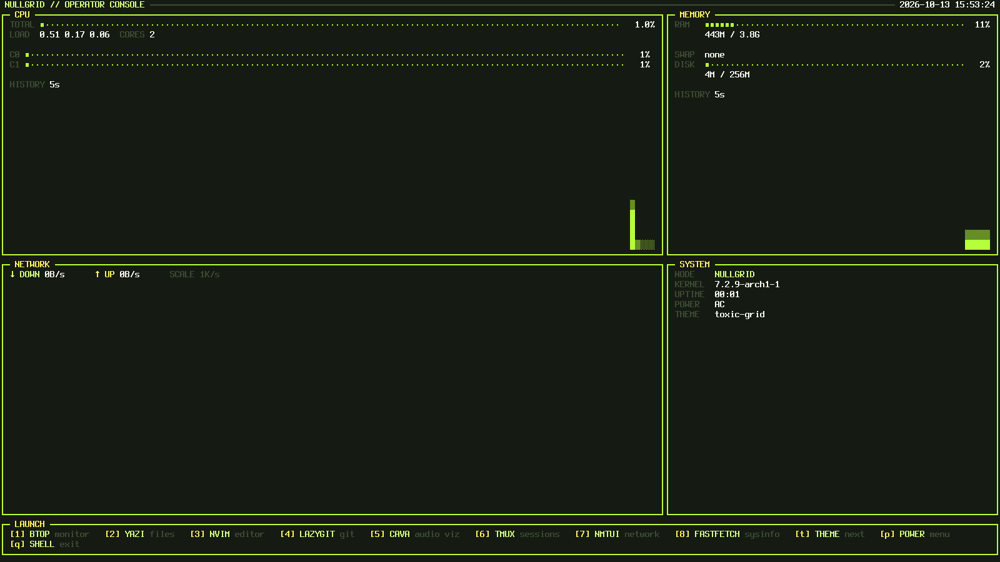 | 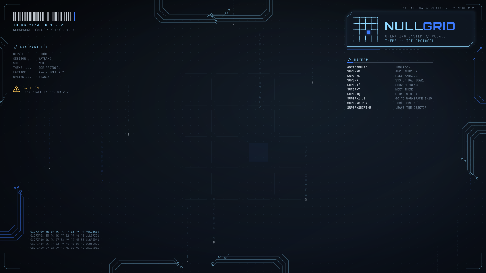 |
| **TTY mode**: the dashboard on the Linux console | **The wallpaper** alone (ice-protocol): circuit traces, logo plate, keymap, data blocks, all generated |
| 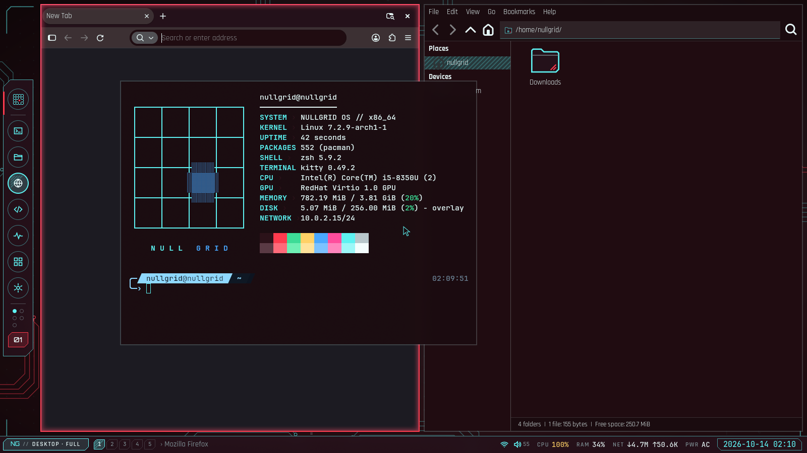 | 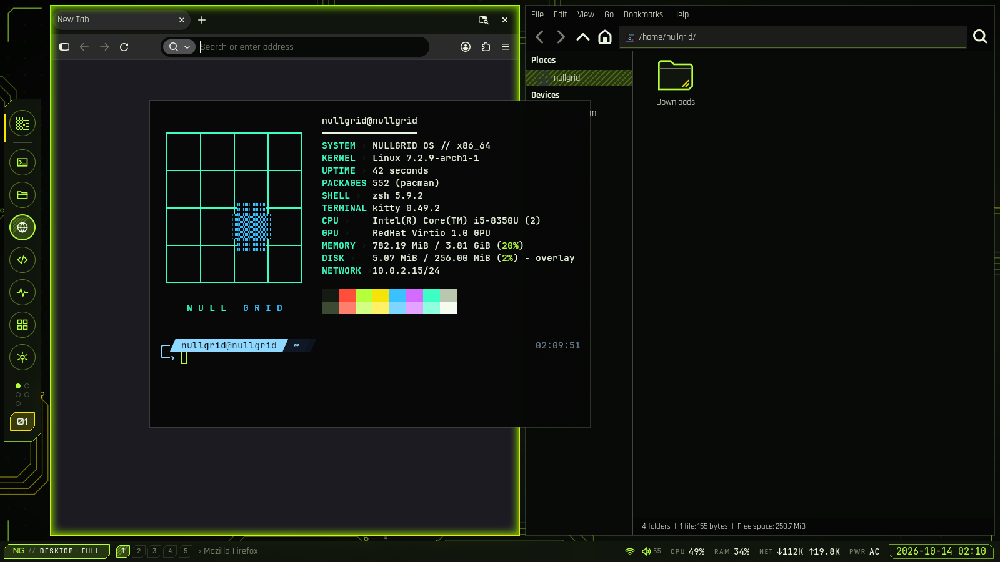 |
| **GUI apps**: Firefox and Thunar in the NULLGRID GTK theme and icons | **The same apps** after `nullgrid theme set toxic-grid`, restyled while running |
| 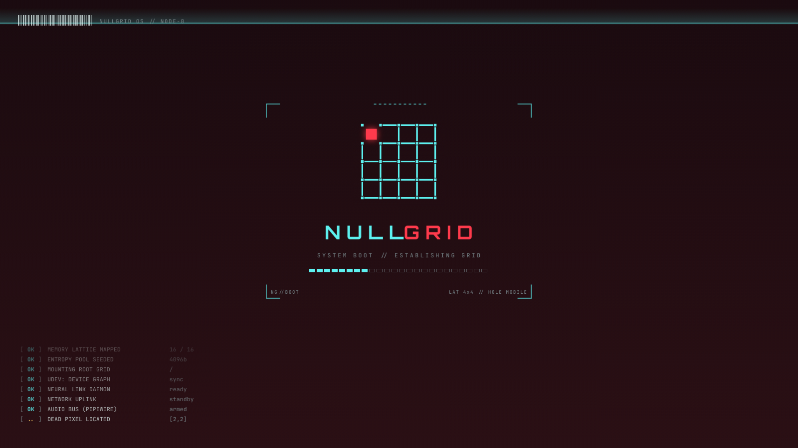 | 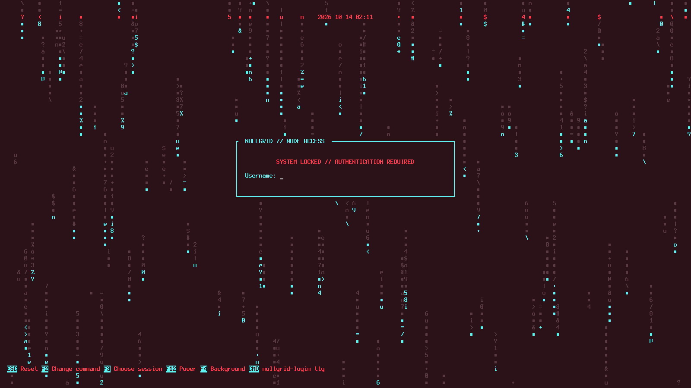 |
| **Boot splash** (Plymouth): the dead pixel wanders the lattice, a fake boot log scrolls | **Greeter** (installed systems): tuigreet over matrix rain; F3 picks desktop or terminal mode |
| 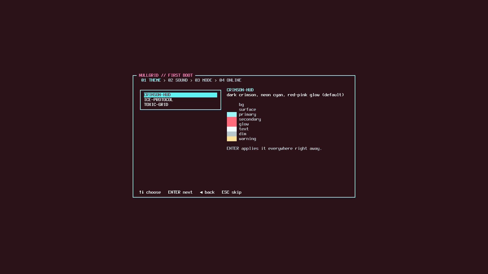 | |
| **First boot** of an installed system (`make test-install`): theme, sound pack, mode | |

## Quick start

```sh
make iso         # build out/nullgrid-*.iso inside Docker (any Linux host)
make run         # boot it in QEMU (UEFI); needs qemu + OVMF on the host
make test        # unit + snapshot tests of the nullgrid tool and the sound daemon (Docker)
make sounds      # synthesize the sound packs into out/sounds (Docker)
make test-shell  # the shell + GTK/Qt apps in a headless Sway: QML errors, live restyle (Docker)
make splash      # preview the Plymouth boot splash (Docker) -> out/screens/splash-*.png
make test-boot   # headless boot test; needs only Docker
make test-install  # install the ISO to a virtual disk and boot it (UEFI + BIOS); Docker
```

Installing: boot the ISO, then start menu → *Install NULLGRID*, or `sudo nullgrid-install`.
See [docs/INSTALL.md](docs/INSTALL.md).

```sh
nullgrid theme list               # crimson-hud, ice-protocol, toxic-grid
nullgrid theme set ice-protocol   # restyle everything live
nullgrid keys                     # the desktop keybinds (SUPER+/ shows them too)
nullgrid sound test all           # hear the active sound pack; sound set minimal-ops, sound mute
nullgrid toolkit apply            # GTK settings, icons and pointer (theme set does it for you)
nullgrid mode tty                 # log in to the TTY dashboard instead of the desktop
nullgrid doctor                   # check config and generated files
```

See [docs/BUILDING.md](docs/BUILDING.md) for requirements and details.

## Docs

- [BUILDING.md](docs/BUILDING.md): build and run
- [CUSTOMIZING.md](docs/CUSTOMIZING.md): `nullgrid.toml`, themes, templates
- [DESKTOP.md](docs/DESKTOP.md): the desktop session, keybinds, wallpaper
- [TERMINAL.md](docs/TERMINAL.md): shell, apps, TTY mode and the dashboard
- [SOUND.md](docs/SOUND.md): UI sounds, events, sound packs
- [TOOLKITS.md](docs/TOOLKITS.md): GTK and Qt apps, icons, cursors
- [BOOT.md](docs/BOOT.md): boot splash, greeter, console colors
- [INSTALL.md](docs/INSTALL.md): installing to a disk, GPU drivers, first-run wizard
- [DECISIONS.md](docs/DECISIONS.md): design choices and why
- [STYLE.md](docs/STYLE.md): visual style guide
- [LOGO.md](docs/LOGO.md): the logo
- [assets/LICENSES.md](assets/LICENSES.md): licenses of all bundled assets

## License

MIT (see `LICENSE`). Bundled third-party assets keep their own licenses (see `assets/LICENSES.md`).
