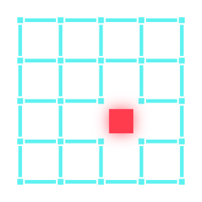

# Logo concepts

> **Chosen (2026-10-13): B, "Dead pixel lattice".** The geometry lives in
> `tools/nullgrid/nullgrid/logo.py`. From it, `assets/logo/generate.py` writes the ASCII logo
> (`nullgrid.txt`, for fastfetch), `nullgrid.svg`, and `nullgrid-small.svg`. The small one is a
> simplified 2x2 variant for 16-32 px. The wallpaper draws the mark itself, in the theme's
> colors. The moving-hole animation is for the Plymouth boot splash (phase 7).
>
> 

All three are pure geometry, so they can be drawn as SVG by a generator script, recoloured per
theme, and still read at 16 px (favicon/tray) and as ASCII (fastfetch).

## A. "Null cell"
A chamfered square plate holding a 3x3 grid of dots. The centre dot is replaced by a **slashed
zero (Ø)**, the "null" symbol, drawn in the secondary accent.
*Null + grid in one mark.* At small sizes it collapses to a slashed circle in a cut-corner frame.

```
 ▗▄▄▄▄▄▄▄▖
 ▐ ·  ·  · ▌
 ▐ · (Ø) · ▌
 ▐ ·  ·  · ▌
 ▝▀▀▀▀▀▀▀▘
```

## B. "Dead pixel lattice" (chosen)
A 4x4 lattice of short cyan line segments with one cell missing; the empty cell glows red.
Reads as "a grid with a hole in it". It works well animated (the hole moves during boot), but is
weaker at 16 px.

## C. "N-trace"
The letter N drawn as a single circuit trace with 45° bends and a via dot at each end, on a
cut-corner plate. Very "cyberdeck", but more generic (many circuit-board logos look like this).

The wordmark in all cases is **NULLGRID** set in Orbitron (OFL), wide-tracked, with the "NULL" half
in the primary accent and "GRID" in the secondary.
